# Apollonio + Artemide: Piano di Sviluppo Completo (Console-Like Shell)

Questo documento rappresenta la **guida tecnica definitiva** per lo sviluppo della nuova esperienza console-like locale basata sui fork:
- **Host / Server**: `MarcoDiGioia/Apollonio` (upstream: `LizardByte/Sunshine` ufficiale + modulo Virtual Display HDR e Supervisor Console Shell, Windows C++23)
- **Client**: `MarcoDiGioia/Artemide` (upstream: `brightcraft/moonlight-tizen` / Moonlight, C++/WASM + HTML/JS per Samsung Smart TV)

---

## 1. Visione e Obiettivi del Progetto

Trasformare il modello di streaming locale da semplice *"desktop mirroring passivo"* a una **sessione console gestita ad oggetti**:
1. **Nero Assoluto**: Il client vede unicamente le applicazioni esplicitamente aperte/gestite. Desktop di Windows, taskbar, icone, notifiche e launcher intermedi (EA, Ubisoft, Battle.net) restano invisibili.
2. **Base App Permanente**: Un'applicazione fa da dashboard principale (primariamente **Steam Big Picture**, con architettura modulare per **Playnite** e **Xbox Console Mode**). Non viene mai chiusa; all'uscita o crash di un gioco, il focus ritorna alla Base App in meno di 1 frame.
3. **Drawer / Quick Menu Lato Client**: Overlay scorrevole su Tizen attivato con pressione prolungata di **Back + Start (800 ms)**, con task switcher, chiusura forzata, impostazioni e tastiera a schermo.
4. **Gestione Intelligente del Mouse**: Cursore di Windows nascosto nello stream in modalità controller. Attivazione automatica dell'emulazione da stick solo quando un menu o popup richiede un puntatore.
5. **Pausa Naturale & Audio Ducking**: Nessun freeze pericoloso a basso livello dei processi (`NtSuspendProcess`), ma sfruttamento del naturale `WM_KILLFOCUS` con attenuazione del volume del gioco in background via WASAPI.
6. **Artemide come Console Companion Client per Sunshine**: Artemide evolve da semplice visualizzatore video passivo a vero e proprio **Companion Client Console**:
   - Pienamente compatibile con qualsiasi installazione di Sunshine standard per stream video e audio.
   - Integra in locale l'overlay Drawer (Quick Menu / Task Switcher), la Tastiera Virtuale nativa, la gestione host e le statistiche di rete.
   - Quando collegato a un host con il Supervisor (`apollonio-shell`), sblocca l'esperienza console completa al 99% (locandine giochi, switch finestre, isolamento a nero e smart mouse).

---

## 2. Architettura di Sistema a 4 Pilastri

```mermaid
flowchart TB
    subgraph Host ["Host: Apollonio (Windows PC o Linux Gaming Rig)"]
        ApolloSvc["Apollonio Server (SYSTEM / Daemon Service)<br/>Capture DXGI/PipeWire, Encoding, Protocollo"]
        ShellSup["apollonio-shell (Supervisor multipiattaforma)<br/>Windows: Win32 HWND + Backdrop Kiosk<br/>Linux: Gamescope / Wayland Compositor Sandbox"]
        BaseProvider["BaseAppProvider (Steam Big Picture / Playnite)"]
        ActiveGame["Gioco in esecuzione"]
        
        ApolloSvc <-->|IPC: Named Pipe (Win) / Unix Socket (Lin)| ShellSup
        ShellSup -->|Gestione Finestre & Z-Order| ActiveGame
        ShellSup -->|Sotto il gioco (mai chiusa)| BaseProvider
        ShellSup -->|Invisibili sotto la sandbox| HiddenLaunchers["Launcher terze parti, Desktop, etc."]
    end

    subgraph Network ["Rete Locale"]
        RTSP["RTSP + RTP Video/Audio (Moonlight standard)"]
        Control["Control Stream Cifrato (Estensioni 0x31xx)"]
        HTTP["HTTP API (/shell/asset per artwork locale)"]
    end

    subgraph Client ["Client: Artemide (Samsung Tizen Smart TV)"]
        WASM["Moonlight Core (C++/WASM)"]
        ComboEngine["State Machine Back+Start (Grace 80ms, Hold 800ms)"]
        DrawerUI["Drawer Overlay (HTML5 / CSS3 / JS)"]
        VirtualKB["Tastiera Virtuale a Schermo (Overlay nativo)"]
        
        ComboEngine -->|Hold 800ms| DrawerUI
        DrawerUI -->|Blocco input verso host| WASM
        VirtualKB -->|LiSendKeyboardEvent| WASM
    end

    ApolloSvc <--> RTSP <--> WASM
    ApolloSvc <--> Control <--> WASM
    ApolloSvc <--> HTTP <--> DrawerUI
```

---

## 3. Protocollo di Controllo: Nuovi Pacchetti `0x31xx`

Estensione del canale di controllo cifrato già presente in Moonlight / Apollo:

| Opcode | Nome | Direzione | Payload (JSON) | Descrizione |
|---|---|---|---|---|
| `0x3100` | `SHELL_HELLO` | Client $\to$ Host | `{"version": 1, "client": "Artemide-Tizen"}` | Negoziazione iniziale all'avvio dello stream |
| `0x3101` | `SHELL_STATE` | Host $\to$ Client | `{"active_app": "Cyberpunk 2077", "game_id": "1091500", "base_provider": "Steam", "cursor_mode": "CONTROLLER"}` | Telemetria inviata a ogni cambio finestra/stato |
| `0x3102` | `SHELL_CMD` | Client $\to$ Host | `{"action": "RETURN_HOME" \| "FORCE_KILL" \| "SWITCH_WINDOW" \| "SET_CURSOR_MODE", "target_id": "..."}` | Comandi esecutivi dal Drawer |
| `0x3103` | `CURSOR_HINT` | Host $\to$ Client | `{"mode": "POINTER" \| "CONTROLLER", "reason": "CURSOR_VISIBLE"}` | Suggerimento dinamico della modalità input |
| `0x3104` | `SHELL_EVENT` | Host $\to$ Client | `{"event": "GAME_CRASHED" \| "GAME_EXITED", "title": "..."}` | Notifiche toast per il client |

---

## 4. Specifiche Dettagliate delle Componenti

### 4.1 Host: `apollonio-shell` (Window Supervisor Multipiattaforma)
- **Linguaggio e toolchain**: C++20/23, compilato con il CMake di Apollonio (MSVC su Windows, GCC/Clang su Linux, cross-compilabile con Zig).
- **Astrazione OS (`IShellPlatform`)**:
  - **Backend Windows (`platform/windows`)**:
    1. Finestra **Backdrop Nero Kiosk** a schermo intero sul display virtuale (classe `ApollonioShellBackdrop`, `WS_POPUP`, nero GDI, `WS_EX_TOOLWINDOW | WS_EX_NOACTIVATE`).
    2. Eventi Win32 via `SetWinEventHook` (`EVENT_SYSTEM_FOREGROUND`, `EVENT_OBJECT_SHOW`, `EVENT_OBJECT_DESTROY`).
    3. **Z-Order forzato**: Gioco attivo in cima $\to$ Base App subito sotto $\to$ Backdrop nero $\to$ Tutto il resto sotto il backdrop.
    4. Neutralizzazione automatica della **Desktop Configuration di Steam Input** (`localconfig.vdf` o template vuoto) per evitare conflitti mouse.
    5. Calcolo della modalità mouse (`CURSOR_MODE`) tramite `GetCursorInfo()` e moduli caricati (`xinput*.dll`, `gameinput.dll`, `sdl*.dll`).
  - **Backend Linux (`platform/linux`)**:
    1. Integrazione con **Gamescope** (il compositor Wayland di Valve per SteamOS) o X11/Wayland dedicato: Gamescope incapsula Steam Big Picture e i giochi in una sessione a tutto schermo isolata senza accesso al desktop.
    2. Rilevamento Steam AppID tramite monitoraggio `/proc` e file di stato `~/.steam/steam/registry.vdf`.
    3. Audio ducking nativo PipeWire/PulseAudio.
- **Interfaccia `BaseAppProvider`**: Astrazione modulare per Steam Big Picture (primario), Playnite ed eventualmente Xbox Console Mode.
- **Canale IPC con Apollonio Server**: Named Pipe su Windows (`\\.\pipe\ApollonioShellPipe`), Unix Domain Socket su Linux (`/tmp/apollonio-shell.sock`).

### 4.2 Host: Modifiche al Core di Apollonio (`src/`)
- **Gestione processi**: Separare il concetto di *Sessione Streaming* (che possiede la Base App) dai *Processi Gioco Gestiti*, superando il modello singleton `proc_t` a singola app.
- **Endpoint HTTP Artwork**: Aggiungere in `src/nvhttp.cpp` l'endpoint `/shell/asset?appid=<id>` per servire le copertine locali da `Steam\appcache\librarycache\<appid>_library_600x900.jpg`.
- **Canale di Controllo**: Registrare in `src/stream.cpp` i gestori per gli opcode `0x31xx` inoltrandoli alla named pipe del supervisor.
- **Audio Ducking**: Invocare le API WASAPI (`IAudioSessionControl2`) per abbassare il volume del processo di gioco in background al 15% quando richiesto dal supervisor.

### 4.3 Client: Artemide (Samsung Tizen)
- **Filtro Combo Gamepad (`wasm/gamepad.cpp`)**:
  - Pressione simultanea di **Back + Start per 800 ms**.
  - **Grace Period (80 ms)**: il primo tasto premuto viene trattenuto localmente. Se il secondo arriva entro 80 ms, entrambi sono trattenuti e parte il timer di 800 ms (zero input spurio inviato al gioco). Se non arriva, il tasto singolo viene rilasciato normalmente.
  - Al raggiungimento degli 800 ms: scatta l'apertura del Drawer e il flag `shellInputCaptured` blocca l'invio di qualsiasi input verso l'host.
- **Drawer Overlay (`wasm/index.html`, `wasm/platform/index.js`, CSS)**:
  - Menu laterale semitrasparente a 60 FPS con navigazione nativa da controller (`wasm/platform/navigation.js`).
  - Card del gioco attivo con locandina locale (artwork).
  - Azioni rapide: Home, Switch finestra, Termina forzatamente (`FORCE_KILL`), Toggle Mouse, Statistiche, Spegni PC.
- **Tastiera Virtuale Nativa**:
  - Overlay HTML/JS con layout QWERTY a schermo.
  - Selezione da D-pad/stick e tasto A.
  - Caratteri digitati inviati all'host via `LiSendKeyboardEvent`.
- **Griglia App con Auto-Launch**:
  - Mantenere la griglia di selezione di Artemide.
  - Aggiungere il flag per-app *"Apri automaticamente all'avvio"* (es. su Steam Big Picture) per saltare la griglia nelle sessioni future.

---

## 5. Roadmap Dettagliata di Implementazione

```mermaid
gantt
    title Roadmap Sviluppo Console-Like Shell
    dateFormat  X
    axisFormat  Fase %x

    section Fase 0: Validazione
    Spike Host shell_probe.exe              :active, p0_1, 0, 1
    Analisi & Test Gamepad Tizen            :active, p0_2, 0, 1

    section Fase 1: Host Supervisor
    Implementazione apollonio-shell.exe     :p1_1, 1, 2
    Backdrop nero & Z-order management      :p1_2, 1, 2
    Steam Big Picture Provider & Config     :p1_3, 1, 2

    section Fase 2: Protocollo & Drawer
    Patch protocollo 0x31xx in common-c     :p2_1, 2, 3
    Bridge WASM-JS in Artemide              :p2_2, 2, 3
    UI Drawer Tizen & Task Switcher         :p2_3, 2, 3
    Endpoint HTTP Artwork locale            :p2_4, 2, 3

    section Fase 3: Mouse Intelligente
    Heuristic detection su supervisor       :p3_1, 3, 4
    Emulazione stick-to-mouse su Artemide   :p3_2, 3, 4
    Toast grafici modalità puntatore        :p3_3, 3, 4

    section Fase 4: Tastiera & Auto-Launch
    Tastiera virtuale HTML/JS overlay       :p4_1, 4, 5
    Supporto caratteri LiSendKeyboardEvent  :p4_2, 4, 5
    Flag auto-launch su griglia Artemide    :p4_3, 4, 5

    section Fase 5: Rifinitura Console 99%
    WASAPI Audio Ducking                    :p5_1, 5, 6
    Frame mask nello shader DirectX VRAM    :p5_2, 5, 6
    Stress test launcher terze parti        :p5_3, 5, 6
```



---

## 6. Mappa dei File Chiave nei Repository

### In `MarcoDiGioia/Apollonio`:
- `tools/shell_probe.cpp`: Tool diagnostico indipendente per la Fase 0 (già presente e compilabile).
- `tools/apollonio-shell/` *(nuovo)*: Sorgenti dell'eseguibile supervisor `apollonio-shell.exe`.
- `src/stream.cpp` & `src/stream.h`: Dispatch dei pacchetti di controllo `0x31xx`.
- `src/nvhttp.cpp`: Endpoint `/shell/asset` per le locandine locali dei giochi.
- `src/process.cpp` & `src/process.h`: Gestione della sessione di streaming disaccoppiata dai singoli processi gioco.
- `src/platform/windows/display_vram.cpp`: Opzionale frame mask shader.

### In `MarcoDiGioia/Artemide`:
- `moonlight-common-c/src/ControlStream.c` & `.h`: Registrazione opcode `0x3100-0x3104` e callback.
- `wasm/gamepad.cpp`: Macchina a stati combo `Back + Start` (Grace 80ms, Hold 800ms) e cattura input.
- `wasm/main.cpp` & `wasm/moonlight_wasm.hpp`: Bridge C++/WASM verso JavaScript (`PostToJs`, `SetShellInputCapture`).
- `wasm/platform/messages.js`: Ricezione messaggi shell da WASM e inoltro alla UI.
- `wasm/index.html`: Struttura DOM del Drawer laterale e della Tastiera Virtuale.
- `wasm/static/css/style.css`: Stili e animazioni per il Drawer, le card artwork e la tastiera.
- `wasm/platform/navigation.js`: Navigazione a croce direzionale del Drawer e della tastiera.
